# SWE-Review Plugin

**Agentic code review on top of Claude Code / Cursor / OpenCode / Pi.**

SWE-Review 把"代码审查"做成 **Generate → Review → (Revise | Regenerate) → Verify** 的闭环：先让 AI 生成候选 PR，再用一个 repository-grounded 审查者探索代码、追踪调用链、产出结构化反馈；reviser 拿着反馈去修；verifier 在沙箱里跑测试。可作为 4 款 CLI 的 `SKILL.md` 安装到 `~/.claude/skills/` 与 `~/.pi/agent/skills/swe-review/`。

---

## 目录

- [1. 系统架构](#1-系统架构)
- [2. 闭环流程](#2-闭环流程)
- [3. 数据模型](#3-数据模型)
- [4. 快速开始](#4-快速开始)
- [5. Skill / SubAgent / Adapter 三层](#5-skill--subagent--adapter-三层)
- [6. CLI 命令](#6-cli-命令)
- [7. 在 Claude Code / Cursor / OpenCode / Pi 中使用](#7-在-claude-code--cursor--opencode--pi-中使用)
- [8. 评测指标](#8-评测指标)
- [9. 安全约束与不变式](#9-安全约束与不变式)
- [10. 参考与许可](#10-参考与许可)

---

## 1. 系统架构

### 三层次总览

```mermaid
flowchart TB
    subgraph User["👤 User / LLM Agent"]
        CLI["swe-review CLI<br/><i>argparse → asyncio</i>"]
        SK["/skill swe-review-*<br/><i>Claude Code / OpenCode / Pi</i>"]
    end

    subgraph Skills["🧠 Skill Layer (skill.py)"]
        direction LR
        ES[ExploreSkill<br/><i>收集仓库上下文</i>]
        AS[AnalyzeSkill<br/><i>静态 diff 分析</i>]
        GS[GenerateSkill<br/><i>生成候选 PR</i>]
        RS[ReviewSkill<br/><i>审查候选 PR</i>]
        RVS[ReviseSkill<br/><i>按反馈修订</i>]
        VS[VerifySkill<br/><i>沙箱验证</i>]
        LS[LoopSkill<br/><i>编排闭环</i>]
    end

    subgraph SubAgents["⚙️ SubAgent Layer (subagents/)"]
        direction LR
        E[ExplorerSubAgent<br/><i>grep + 调用链追踪</i>]
        A[AnalyzerSubAgent<br/><i>hunk 统计 + API 检测 + 冗余信号</i>]
        G[GeneratorSubAgent<br/><i>LLM 生成 diff</i>]
        R[ReviewerSubAgent<br/><i>LLM 审查 + JSON 报告</i>]
        RV[ReviserSubAgent<br/><i>LLM 修订 diff</i>]
        V[VerifierSubAgent<br/><i>git apply + 测试</i>]
        L[LoopSubAgent<br/><i>状态机 + 策略分发</i>]
    end

    subgraph Adapters["🔌 Adapter Layer (tools/)"]
        CCA[ClaudeCodeAdapter<br/><i>claude -p</i>]
        CA[CursorAdapter<br/><i>agent --print</i>]
        OA[OpenCodeAdapter<br/><i>opencode run</i>]
        PA[PiAdapter<br/><i>pi --mode print</i>]
        HA[HostAdapter<br/><i>prompt 落盘，宿主自答</i>]
        ST[ShellTools<br/><i>离线占位</i>]
    end

    User --> CLI & SK
    CLI --> Skills
    SK --> Skills
    Skills --> SubAgents
    SubAgents -.->|chat / call LLM| Adapters
```

### 数据流

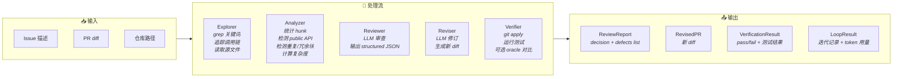

---

## 2. 闭环流程

SWE-Review 提供 **3 种闭环策略**，由 `LoopSkill` 统一编排：

### 2.1 策略总览

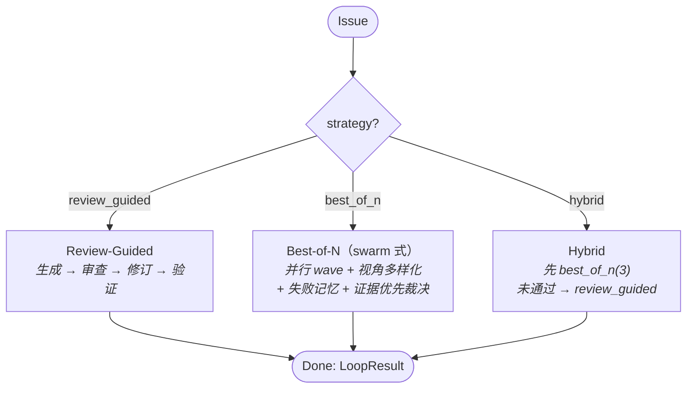

### 2.2 Review-Guided（默认）

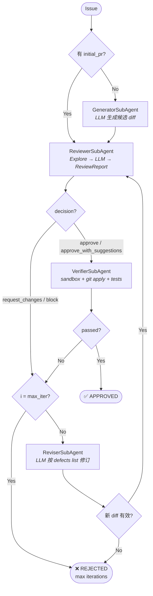

### 2.3 Best-of-N（Swarm 式并行 wave）

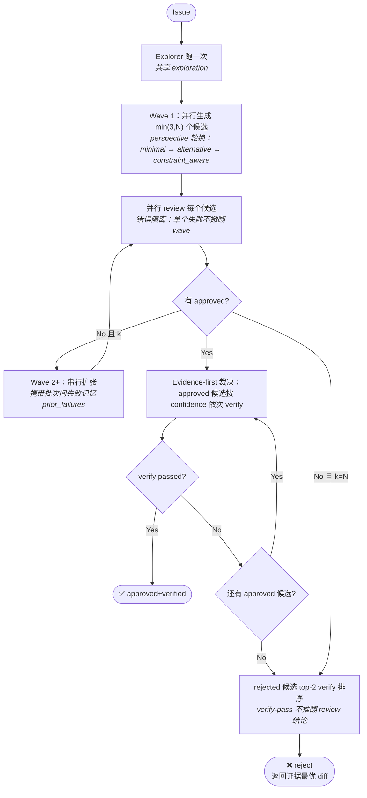

关键设计（源自 SWE-Gate 实证与 swarm 编排原则）：

- **并行 wave + 共享探索**：Wave 1 的多个候选并行生成/评审，且所有候选复用**同一次** explorer 结果（此前每个候选各跑一次 explorer，纯冗余）。
- **视角多样化**：同一 prompt 采样 N 次会产生高度相关的候选；改为每个候选注入不同 `perspective`（minimal / alternative / constraint_aware）。minimal 走 simplicity ladder（需要存在吗 → 仓库已有 → 标准库 → 一行？都不成立才新增代码）；constraint_aware 主动满足错误语义、作用域泛化、生命周期清理、编码转义四类高危评审约束。
- **批次间失败记忆**：Wave 2+ 的生成会收到此前所有被拒候选的紧凑摘要（rationale + decision + top findings，不含 diff），避免重复已失败路径。
- **Evidence-first 裁决**：approved 候选必须 verify 通过才算 success——review 的语言描述不再能单独决定结果；全部 approved 候选 verify 失败时，对 rejected 候选按 confidence 取 top-2 跑 verify 做证据排序，但 verify-pass **不推翻** review 的拒绝结论（功能测试通过 ≠ 可接受）。

### 2.4 Hybrid

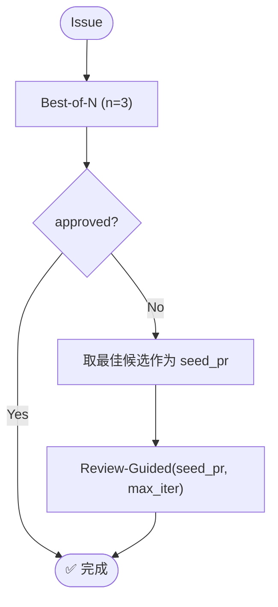

传入 `initial_pr`（`--initial-pr-diff`）时 hybrid **跳过 best_of_n 阶段**，直接进入
Review‑Guided：显式给出的候选补丁就是「要审这份」，先生成 N 个新候选只会把调用方
传入的补丁静默丢弃。此时 `--n-best-of` 不生效。

### 2.5 完整序列（review_guided 策略）

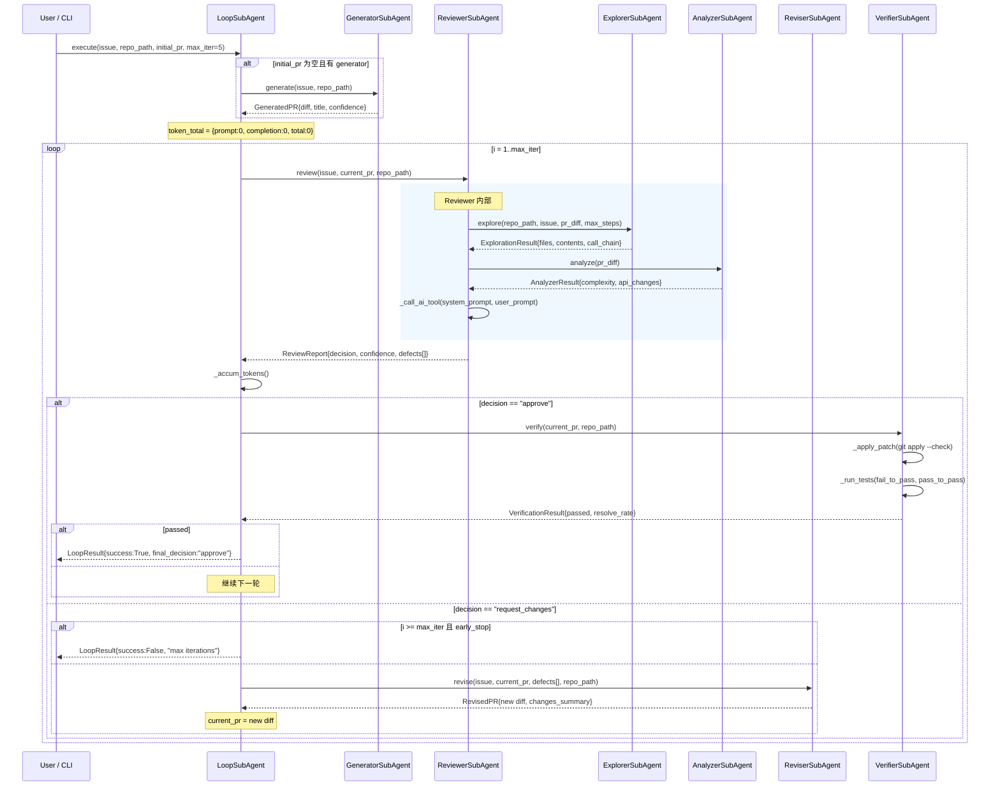

---

## 3. 数据模型

核心 dataclass 关系：

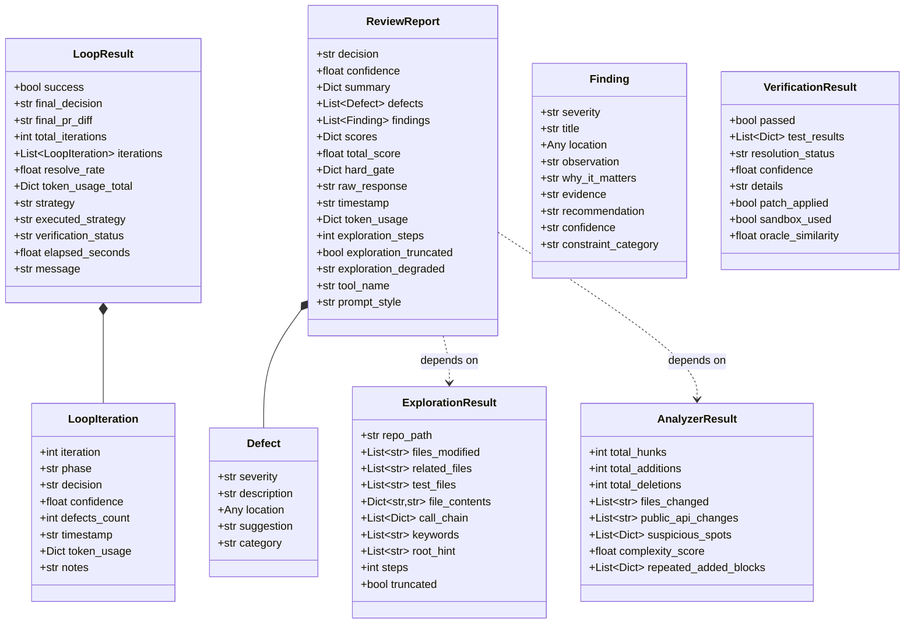

---

## 4. 快速开始

```bash
# 1. 安装
cd swe-review-plugin
./install.sh
source .env.local

# 2. 看工具可用性
swe-review list-tools

# 3. 跑一次 review
swe-review review \
    --issue "Bug description" \
    --pr-title "Fix ..." \
    --pr-diff ./sample.diff \
    --repo-path /path/to/repo \
    --tool pi

# 4. 跑 review_guided 闭环
swe-review loop \
    --issue "Bug" \
    --repo-path /path/to/repo \
    --tool pi \
    --strategy hybrid \
    --max-iterations 5

# 5. 安装 SKILL.md 到 Pi（install.sh 已经做过；这里手动重做）
swe-review install-skills
```

### 完整测试周期

`install.sh` 提供 6 个子命令。默认是 `install`：

| 子命令 | 说明 |
|-------|------|
| `./install.sh install` | 安装 swe-review 包 + 为仓库 `.claude/skills/`（唯一源）创建符号链接到 `~/.agents/skills/`、`~/.claude/skills/`、`~/.pi/agent/skills/` |
| `./install.sh uninstall` | 卸载 swe-review 包 + 清除 SKILL.md 符号链接（不动仓库）+ 删除 `.env.local` |
| `./install.sh verify` | 运行单元测试（pytest）+ `swe-review list-tools` |
| `./install.sh e2e` | `install` → `verify` → `uninstall` 全闭环幂等测试 |
| `./install.sh test-all` | `install` → 4 个 CLI smoke → `uninstall` 闭环 |
| `./install.sh test-tool pi` | `install` → 单个 CLI 跑一次 `review` → `uninstall` 闭环 |

`test-all` 输出末尾会给出各 adapter 的健康状态：

```
==== Phase 2 总结 ====
  claude-code    PASS  ok
  cursor         FAIL  RuntimeError  （Cursor 服务端 quota，与代码无关）
  opencode       PASS  ok
  pi             PASS  ok
```

每个 adapter 都提供 `diagnose()` 方法，将错误原因反馈到 `swe-review health`。

### Python API

```python
import asyncio
from swe_review import ReviewSkill, ClaudeCodeAdapter

async def main():
    skill = ReviewSkill(tool_adapter=ClaudeCodeAdapter())
    res = await skill.execute(
        issue="NullPointer in user_service.get",
        pr_title="Add null check",
        pr_diff=open("pr.diff").read(),
        repo_path=".",
    )
    print(res.payload)  # → SkillResult {ok, payload: ReviewReport.to_dict()}

asyncio.run(main())
```

---

## 5. Skill / SubAgent / Adapter 三层

### 5.1 Skill 层（`swe_review/skill.py`）

每个 Skill 是给上游 LLM/用户调用的"一段可复用能力"，负责准备上下文、触发 SubAgent、封装对外结果。

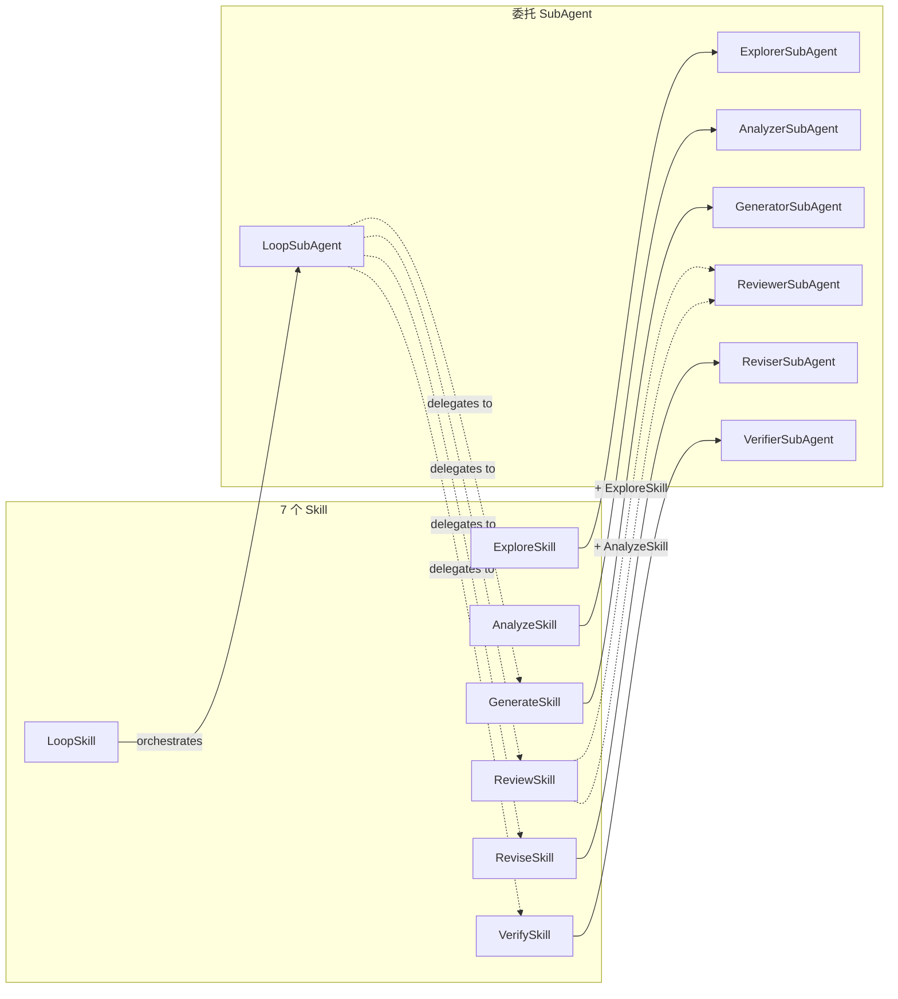

| Skill | 用途 | 对应 SubAgent | 额外依赖 |
|------|------|---------------|----------|
| `ExploreSkill` | 收集仓库上下文 | `ExplorerSubAgent` | — |
| `AnalyzeSkill` | 静态 diff 分析 | `AnalyzerSubAgent` | — |
| `GenerateSkill` | 基于 issue 生成候选 PR | `GeneratorSubAgent` | `ExploreSkill` |
| `ReviewSkill` | 审查候选 PR | `ReviewerSubAgent` | `ExploreSkill` + `AnalyzeSkill` |
| `ReviseSkill` | 按审查反馈修订 PR | `ReviserSubAgent` | — |
| `VerifySkill` | 沙箱 apply + 测试 | `VerifierSubAgent` | — |
| `LoopSkill` | 编排闭环 | `LoopSubAgent` | 上述全部 |

#### Reviewer prompt styles（`prompt_style`）

| style | 定位 |
|---|---|
| `engineering`（默认） | **高级代码审查**：审查对象是 Change 而非 Bug。8 维度 100 分制评分（Design 20 / Maintainability 15 / Consistency 15 / Simplicity 10 / Readability 10 / Testability 10 / Risk 10 / Change Scope 10）+ P0–P4 证据绑定 findings + Hard Gate + 4 档决策（APPROVE / APPROVE_WITH_SUGGESTIONS / REQUEST_CHANGES / BLOCK）。先理解再评价，Project Convention > Generic Best Practice，禁止低价值评论。含 **Review-Constraint Deep Check**（SWE-Gate 启发）：对错误语义、Schema/元数据/类型、作用域泛化、生命周期清理、编码/转义五类高频评审约束定向核查，外加 **Simplicity Ladder**（ponytail 启发）——对 diff 中每个新增抽象/helper/依赖逐级核查（是否真实需要 → 仓库已有等价实现 → 标准库已提供 → 平台原生 → 已装依赖 → 能否一行 → 最少代码），违规的 recommendation 必须指明具体替代物。命中的 finding 标注 `constraint_category`（11 类 canonical 词表，prompt 与 parser 共享同一常量）。输出契约要求 **findings 先于 scores** 且各字段长度克制——输出被截断时丢失尾部的 scores 而不是 findings。 |
| `concise` | legacy bug-fix-centric：判断 patch 是否修复 issue 根因。 |
| `detailed` | legacy bug-fix-centric：Step 1→6 workflow + symptom-fix detection。 |

engineering 报告同时把 findings 映射为 legacy `defects`（P0/P1→high，P2→medium，P3/P4→low），revise/loop 下游无需改动；`approve_with_suggestions` 与 `approve` 一样终止闭环为成功，`block`（Hard Gate / P0）与 `request_changes` 触发修订。

#### 反臃肿检查（Anti-Bloat / Patch-Stacking）

针对 AI Coding Agent 最典型的失效模式——**打补丁式编程**：发现一个问题就新增一个 `bool`，发现边界情况再加一个 `flag`，两个逻辑冲突再加中间变量，为不影响旧逻辑再加一层判断；原本 10 行的事变成几十行加多个变量。

三处落地，缺一不可：

1. **静态证据层**（`detect_bloat_signals`，纯规则无 LLM）：`Patch Analysis` 输出 `bloat_signals`，六类信号分别对应一种叠加模式。

   | 信号 | 触发条件 |
   |---|---|
   | `additive_only_change` | **既有**文件新增 ≥8 行实质代码且删除 0 行（单文件不达标时按跨文件合计判定） |
   | `flag_accumulation` | 新增 ≥2 个布尔型状态变量 |
   | `guard_stacking` | 新增 ≥3 个条件分支且**未**改写任何既有分支 |
   | `compat_layer` | 新增 ≥2 个**不同**的 fallback / legacy / workaround 机制 |
   | `wrapper_growth` | 既有文件中 ≤40 行的新增改动引入了新的顶层 def/class |
   | `field_list_duplication` | 同一组 ≥2 个字段名同时出现在**声明处**与**映射处**，且分属两个文件 |

   阈值一律设在 1 以上：**新增一个必要变量或一个 guard 属于正常工程，不予报告**。信号是线索而非结论，判定不成立时须说明理由后驳回。

   `field_list_duplication` 与其余五类性质不同——它不是逐行模式。新增模型字段 `final bool stereoCharging;` 与映射项 `'stereoCharging': o.stereoCharging,` 是**不同文本**，整行重复检测看不见它们，任何行级模式也无法判断这是同一事实写了两遍。因此判定改用**键集合重合**：只有同一组 ≥2 个字段名在声明侧与映射侧同时出现、且分属两个文件时才触发。这种共现才意味着清单被复制——下一个字段必须两处都改，否则它会静默停止往返序列化，**既不报编译错误，往往也没有测试覆盖**。

   刻意保守：只加一个新结构体的多个字段（无映射）不报；同文件内的 `fromMap`（合理共存）不报；键名被重命名（`providerId` → `provider_id`）因无同名交集而**保持沉默**——这是文字层的已知边界，已在提示词中写明，由模型在 context 中自行核查，而不是让静态层去猜。

   散文不算代码：注释、docstring/块字面量（含由**未改动上下文行**开启的 docstring，以及多行函数签名的收尾行）、prompt 字符串字面量、仅命名概念的符号定义行，以及非代码文件（`*.md` / `*.toml` / `*.yaml` 等）与测试文件都不参与信号匹配。每一条排除都对应一个在自审中实测到的误报——用新检测器审它自己的源码时，这些误报被逐一发现并钉进回归测试。

2. **评审提示契约**：system prompt 新增「Anti-Bloat / Patch-Stacking Deep Check」专项段，内置**修改策略优先级**（改现有逻辑 > 复用已有 > 简化结构 > 加一个变量 > 加多个状态 > 新增并行逻辑）、逐项反模式清单（Flag 堆积 / 分支叠加 / 只加不删 / 兼容层滥用 / 包装层增殖 / 中间变量冗余 / **字段对象膨胀** / **字段清单多处维护**），并把「系统性臃肿」定义为可触发 Hard Gate 的 Severe Maintainability Problem。评审流程由 21 步扩为 22 步，反臃肿检查是独立一环。

3. **必填定量自查**：输出契约新增 `complexity_delta`（`new_state_vars` / `new_functions` / `derivable_state` / `removable_old_code` / `net_complexity`），回答「新增了几个变量、几个方法、有无可推导的新变量、有无可直接删除的旧代码、整体变复杂了吗」。`net_complexity: increased` 却没有任何对应 finding 或 action，视为无证据支撑的评分。

写入侧同步收紧：generator 对**所有** perspective 施加反臃肿规则（diff 允许删除多于新增），reviser 明确要求「优先做减法」——不新增 flag 去修复既有 flag；`constraint_category` 会随 finding 透传到 `defects[]`，让修订端能区分「删掉冗余状态」与「补上缺失分支」。

反臃肿不等于追求最短 diff：可读性、正确性、类型安全不得为「少写几行」让路。

### 5.2 SubAgent 层（`swe_review/subagents/`）

执行单元，全部有 `name / capabilities / get_status` 元信息。

| SubAgent | capabilities | 核心方法 |
|----------|-------------|----------|
| `ExplorerSubAgent` | `file_search, code_analysis, dependency_tracking, test_discovery` | `execute(context)` → `ExplorationResult` |
| `AnalyzerSubAgent` | `static_diff_analysis, api_surface_check, complexity_estimate` | `execute(context)` → `AnalyzerResult` |
| `GeneratorSubAgent` | `generate_patch, diff_formatting` | `execute(context)` → `GeneratedPR` |
| `ReviewerSubAgent` | `analyze_diff, explore_repository, generate_report, decision_making` | `execute(context)` → `ReviewReport` |
| `ReviserSubAgent` | `parse_feedback, generate_fix, validate_diff` | `execute(context)` → `RevisedPR` |
| `VerifierSubAgent` | `run_tests, compare_patches, verify_resolution, sandbox_apply` | `execute(context)` → `VerificationResult` |
| `LoopSubAgent` | `orchestrate_loop, track_iterations, early_stopping, best_of_n` | `execute(context)` → `LoopResult` |

所有 SubAgent 接收的 `context` 字典是显式 schema —— **拒绝** `golden_patch`、`test_info`、`oracle` 等污染字段（验证器除外）。

同级还有一个**纯函数模块**（不是 SubAgent，因为分片必须确定性）：

| 模块 | 作用 |
|------|------|
| `diff_sharding` | 把大 diff 按文件切成预算内的分片（`plan_shards` / `should_shard` / `split_file_blocks`），供 `ReviewerSubAgent` 做并发 map-reduce 审查 |

### 5.3 Adapter 层（`swe_review/tools/`）

只负责 `chat(system, user) → (text, token_usage)`。所有 adapter 共享 `BaseAdapter` 接口：

```python
class BaseAdapter:
    async def chat(self, system: str, user: str,
                   max_tokens: int = 4096, temperature: float = 0.1
                   ) -> Tuple[str, Dict[str, int]]: ...
    def get_status(self) -> Dict[str, Any]: ...
    def diagnose(self) -> Dict[str, Any]: ...
```

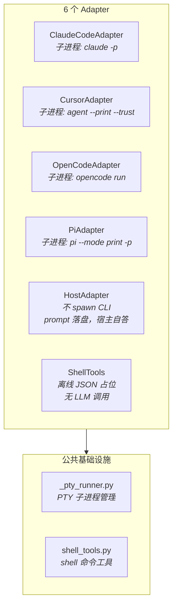

| Adapter | CLI 二进制 | Headless 模式 | 技能自动安装 |
|---------|-----------|---------------|-------------|
| `ClaudeCodeAdapter` | `claude` | `claude -p --output-format json` | ❌ |
| `CursorAdapter` | `agent` | `agent --print --trust` | ❌ |
| `OpenCodeAdapter` | `opencode` | `opencode run` | ❌ |
| `PiAdapter` | `pi` | `pi --mode print -p --system-prompt ...`（系统提示替换 pi 默认 coding-assistant prompt，避免模型在 `--no-tools` 下仍输出 `<tool_call>`） | ✅ → `~/.pi/agent/skills/` |
| `HostAdapter` | (无) | **不 spawn 任何 CLI**：prompt 落盘，由「正在运行的 agent」自己回答（见 §6 Host mode） | — |
| `ShellTools` | (无) | 返回占位 JSON | ❌ |

---

## 6. CLI 命令

```
swe-review list-tools                                  # 列出 adapter 健康状况
swe-review health                                      # 每个 adapter 发一次 trivial prompt
swe-review install-skills [--source ...] [--pi-skills-dir ...]

swe-review review    --issue ... --pr-diff ... [--tool {auto|claude-code|cursor|opencode|pi|host|shell}] \
                     [--prompt-style engineering|concise|detailed] [--deep] \
                     [--timeout 1200] [--no-shard] [--shard-budget 400000] \
                     [--shard-concurrency 4]

swe-review revise    --issue ... --pr-diff ... [--tool ...] \
                     --review-report ... [--feedback-level full_feedback] [--timeout 1200]

swe-review loop      --issue ... --repo-path . [--tool ...] \
                     [--strategy hybrid] [--max-iterations 5] [--n-best-of 3] [--timeout 600] \
                     [--sandbox|--no-sandbox] [--no-shard] [--shard-budget 400000] \
                     [--shard-concurrency 4]

swe-review verify    --pr-diff ... \
                     [--repo-path .] [--sandbox|--no-sandbox] [--test-info ...] [--oracle ...] \
                     [--test-runner "python -m pytest {test} -q"]
```

`--tool` 默认 **`auto`**：按 `claude-code → cursor → opencode → pi` 的顺序，选第一个
在 `$PATH` 上真实可解析的 CLI。探测只查二进制可用性、不发网络请求、不打试探 prompt，
因此开销恒定；装好但配置错的 CLI 会在真正调用时报出自己的错误，比"找不到工具"更有
指导性。

`auto` **绝不会**落到 `shell` 或 `host`：前者不调用任何 LLM，后者需要外部 agent 回答
落盘 prompt，自动选中都会悄悄改变"审查"的含义。若本机一个 CLI 都没有，命令以退出码
2 失败并列出查找过的二进制名——不再回退到占位实现。

> 此前默认值是 `shell`——它恒返回固定 `request_changes` 载荷，于是
> `swe-review review` 会打印一份结构完整、带评分、措辞确信却零分析的报告并以退出码 0
> 收尾。这是"AI 自审 PR"最危险的失败模式，`auto` 取代它是为了保持省略 `--tool` 仍可
> 用，同时确保调用的一定是真实后端。

若报告确实来自 `shell` 或探索降级，payload 顶层会带 `degraded: [...]` 字段（见下文
"证据可信度"），调用方无需解析散文即可判断。

#### 可观测行为变更（v1.0.0 → 本次修复）

以下都是**对外可见的语义变更**，如果你的脚本读取这些字段请对照迁移：

| 字段 | 变更前 | 变更后 | 影响与迁移 |
|---|---|---|---|
| `--tool` 默认值 | `shell`（不调用 LLM） | `auto`（自动探测真实 CLI） | 省略 `--tool` 的调用**不再**走占位实现。若你的 CI 依赖旧的占位行为做冒烟测试，显式写 `--tool shell` |
| `--tool` 无可用 CLI 时 | 静默回落 `shell`，退出码 0 | 退出码 2 + stderr 提示 | 依赖"总是成功"的脚本需要处理退出码 2，或显式指定 `--tool` |
| `ShellTools.get_status()["configured"]` | `true` | `false` | 这是**有意的契约收紧**：`configured` 回答的是"是否接入了真实 LLM"，占位实现没有。按 `configured` 过滤"可用后端"的脚本现在会正确排除 `shell`。若你只想识别占位实现而不想改变可用性判断，改用新增的 `is_placeholder: true`。仓内没有任何代码消费此字段（改动前已用 grep 核实），因此对本项目自身无影响；该声明针对的是外部脚本 |
| `ShellTools.get_status()["is_placeholder"]` | 不存在 | 新增 `true` | 纯新增，无破坏 |
| `LoopResult.executed_strategy` | 不存在 | 新增；`strategy` 改为只记用户**请求**的策略 | 纯新增字段。注意 `strategy` 语义收紧了：`best_of_n` 在显式 `initial_pr` 下会委托 `review_guided`，此前 `strategy` 被覆写成 `best_of_n` 掩盖了这一点。判断"真实跑了哪条编排路径"请读 `executed_strategy` |
| `payload.degraded` | 只有 review 带 | review、revise **和** generate 都带 | 纯新增字段（`verify` 刻意不带，见不变式矩阵） |
| `install-skills` 空源 | 输出 `{"installed": {}}`，退出码 0 | 退出码 1 + stderr 提示 | 依赖退出码 0 判断成功的脚本现在能正确发现路径配错 |

`--tool shell` 仍可显式指定，用于 CI 里跑通数据流的冒烟测试。

完整参数见 `swe-review -h`。`--timeout` 省略时各 adapter 保留自己的默认值
（claude-code/opencode 1800s，pi/cursor 600s）；engineering 审查一份大 diff 常需
6–9 分钟，用 pi 时建议显式给 `--timeout 1200` 以上。`verify` 不需要 `--tool`
（它不调 LLM）。`--no-sandbox` 在 `verify` 与 `loop` 上都可用——iOS 增量编译需要
复用 `Pods/`、`DerivedData` 时就靠它。

### 大 diff 自动分片（map-reduce 审查）

review prompt 的体积**几乎全由原始 diff 决定**（实测一份 180 KB 的 diff 占 98%，
单次 prompt ≈ 45.6k tokens）。而 `pr_diff` 曾是唯一**没有任何预算**的 prompt 输入
（repo_context 60k、exploration 40k、reviser diff 50k 都有上限）。于是超大改动会
直接把上下文顶爆，且整轮审查串行压进一次请求。

现在超过 `--shard-budget`（默认 400k 字符，见下方实测取舍）的改动才会按**文件**切成
若干片**并发**审查，再归并：

```
        一个 180 KB / 42 文件的 diff
                    │
        ┌───────────┴───────────┐  plan_shards() 确定性切分
        │  按文件打包，绝不切开一个文件或一个 hunk
        └───────────┬───────────┘
    ┌───────┬───────┼───────┬───────┐   asyncio.gather（受 --shard-concurrency 限制）
  shard1  shard2  shard3  shard4      各自带上「SHARD k/N + 本片文件清单」的作用域说明
    └───────┴───────┼───────┴───────┘
                    │  merge_findings()：并集 + 去重 + 按严重度排序（纯代码，不经模型）
                    ▼
          一次 synthesis 调用 → 全局 8 维评分 / decision / hard_gate / summary
```

要点：

- **切分是确定性的**（`subagents/diff_sharding.py`，不调 LLM）：按 diff 顺序把文件
  打包到预算内，**一个文件的 hunk 绝不跨片**（只看半个文件会凭空产出「缺失」类
  findings），**hunk 绝不切开**；单个文件超过预算则独立成片并标记 `oversized`。
- **作用域说明是必需的**，不是装饰：每片的 prompt 明确写「本片只有 k/N 个文件，
  不要对看不到的文件提『缺失/不一致』」。少了这句，分片审查必然产出跨文件假阳性。
- **分片的输出契约与整轮审查不同**：分片只产 `decision` / `findings` / `hard_gate`，
  **不产** 8 维评分与 summary。这些会被后续 synthesis 覆盖，要求分片产出只会让每片的
  completion 涨到接近整轮的量级——实测这会把并行的收益全部吃掉（4 片 13.6k
  completion tokens vs 单次 2.3k）。契约写在 prompt **末尾**（末尾指令模型才会遵守）。
- **findings 由确定性代码归并**——证据在哪片，就只有那片有，所以决定一条 finding
  去留的绝不能是模型。synthesis 只负责**判断**（评分/decision/summary），并且它
  产出的 findings 会被丢弃、由归并结果覆盖。
- **降级路径**：某片解析失败 → 记入 `summary.degraded_shards` 并继续；synthesis
  不可用 → 退回**确定性最坏值聚合**（decision 取最严；分片只产 findings 时没有评分可
  聚合，此时会在 summary 里显式声明「scores are unavailable」而不是悄悄给一份没分数的
  报告）；所有片都失败 → 返回 `request_changes` + `parse_error`，**绝不伪造 approve**。
- 只对 **engineering** 风格生效；concise/detailed 有各自的 prompt 体系，硬套会让
  审查语义悄悄改变。预算低于 1000 会被抬到 1000。

#### ⚠️ 关于「并发应该更快」：实测不会（除非单次调用装不下）

一个自然的预期是「总工作量增加了，但可以并发，所以墙钟时间应该下降」。**本项目的实测
不支持这个结论**，原因值得写清楚，因为它决定了这个功能该怎么用。

同一份 271 KB / 42 文件的改动，**每次调用的 prompt 都带随机 nonce 以保证不被缓存**
（见下方缓存警告）：

| | 单次调用 | 分片（5 片 + 综合） |
|---|---|---|
| 墙钟 | **35.5 s** | **71.5 s**（约 2×） |
| 峰值单请求 prompt | 69 k tokens（**随 diff 线性增长，无上限**） | ~每片 15–30 k（**与总量解耦**） |
| 总 completion | 2,341 | 8,424（**3.6×**） |

**为什么并发没换来提速**：只有「同一份工作切成 N 份」时 `工作/N` 才成立。而 fan-out
在这里**不切分工作，而是增加工作**——每片都要写出自己那份 findings 报告，另外还有一次
**串行**的综合调用要再写一份完整报告。墙钟由**输出生成**决定（不是 prompt 大小），所以
总输出涨到 3.6 倍时，并行的收益不可能覆盖它。

关键路径因此是：

```
墙钟 ≈ max(单片的时延) + 综合调用的时延      ← 后者是硬屏障，必须等所有片结束
```

实测两者量级相当（单片阶段 33–37 s，综合 20–45 s），所以合计必然大于单次调用。

**它真正的价值是「单次调用装不下」**：那时替代方案是报错或极慢的请求，而分片把每个
请求的 prompt 压回窗口内。所以默认阈值设在接近 128 k 窗口的位置（400 k 字符 ≈ 100 k
tokens 的 diff），**而不是「稍大就分片」**。

| 场景 | 用法 |
|---|---|
| 默认：仅在单次调用有超窗风险时分片 | 不传（400k） |
| 接受更慢的墙钟，换取最紧的峰值 prompt | `--shard-budget 60000` |
| 最低总成本，且 diff 装得下 | `--no-shard` |

**两个已知的可优化点**（都没做，因为都不改变上面的量级结论）：

1. **综合调用偶发会重试**（`max_regen_attempts`，默认 3 次）。每次重试都是一次完整的
   报告生成，会把这道屏障的耗时放大到 3 倍。孤立复现时它一次即成功（20.9 s、1 次调用），
   所以是偶发；一旦触发，分片的墙钟会明显恶化。
2. **减少总输出**才是唯一能真正提速的方向：例如让分片只回结构化 findings（不写散文），
   或把综合的 `whats_good`/`recommended_actions` 改为由各片 findings 确定性汇总。

⚠️ **缓存警告（会影响任何 A/B 测评）**：`pi` CLI 会按 prompt 缓存响应——同一条 prompt
第二次调用实测 2.86 s → 0.32 s（快 9 倍）。任何复用 prompt 的对比测量都是无效的，必须
在 prompt 里放随机 nonce。

（对照：上游**确实**并行服务并发请求——5 条各不相同的请求并发耗时是单条的 1.57×，
而非 5×。所以瓶颈不在上游，而在上面的工作量与屏障结构。）

⚠️ **分片与单次调用的评分不可直接比较**：分片时每片只看到自己那几个文件，全局判断由
综合调用基于 findings 重新作出，所以 `total_score` 会与单次调用有差异（实测 84 vs 66）。
把评分当作门禁时请固定一种模式。

`swe-review review` 的输出会在 `summary.sharded_review` 写明实际片数、有无
`oversized` 片、以及是否退回了确定性聚合（有片失败时另有
`summary.degraded_shards`），便于判断这次到底走了哪条路径。

### Host mode（`--tool host`）：让当前 agent 自己当 LLM

不 spawn `claude`/`pi`/`opencode` —— prompt 落盘，由**正在运行本命令的 agent**
用自己的模型回答，然后原样重跑同一命令继续：

```bash
swe-review loop --issue "Fix NaN" --repo-path . --tool host --host-dir .swe-host
# 退出码 3 = awaiting_host：stdout 给出 key + request_path + 指引
swe-review host pending  --host-dir .swe-host --show          # 读待答 prompt
swe-review host answer   --host-dir .swe-host --key <key> --text-file ans.json
swe-review loop --issue "Fix NaN" --repo-path . --tool host --host-dir .swe-host
# 已答 prompt 从缓存重放，循环推进到下一阶段；退出码 0 = 完成
```

`--agent` 只是把标签写进 request（如 `--agent cline`）。答案可以直接用模型的裸
输出，或 `{"text": ..., "usage": {...}}` 记录 token。任何 agent（不限那 4 款 CLI）
都能这样驱动 `review` / `revise` / `loop`；无人值守场景仍用 4 个 CLI adapter。

### CLI 层架构

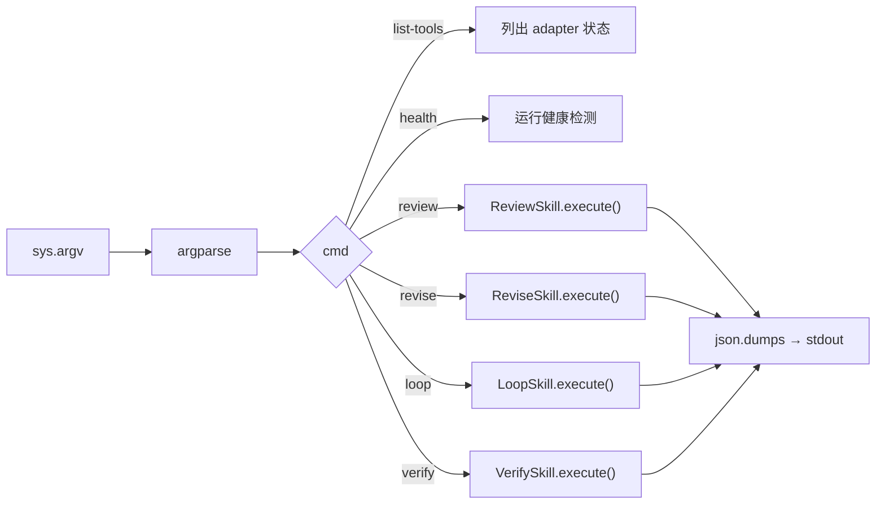

---

## 7. 在 Claude Code / Cursor / OpenCode / Pi 中使用

### 7.1 Claude Code / OpenCode

`./install.sh` 为仓库 `.claude/skills/`（唯一源）创建符号链接到 `~/.claude/skills/swe-review-*/` 等三处发现路径。OpenCode 默认加载该目录：

```
/skill swe-review-review  --issue "..." --pr-diff ./patch.diff
/skill swe-review-loop    --issue "..." --repo-path . --strategy hybrid
```

### 7.2 Pi

```
/skill:swe-review-review --issue "..." --pr-diff ./patch.diff
/skill:swe-review-revise --issue "..." --pr-diff ./patch.diff --review-report ./report.json
```

Pi 把 `~/.pi/agent/skills/` 当成发现根目录。`PiAdapter` 还会按需把 SKILL.md 复制到该路径下。

### 7.3 Cursor

Cursor 终端无原生 `skill` 概念，但 `agent --print --trust` 会被 `CursorAdapter` 包装成 headless 执行。建议在 Cursor 终端直接调用：

```bash
swe-review review --issue "..." --pr-diff ./fix.patch --tool cursor
```

### Skill 发现路径

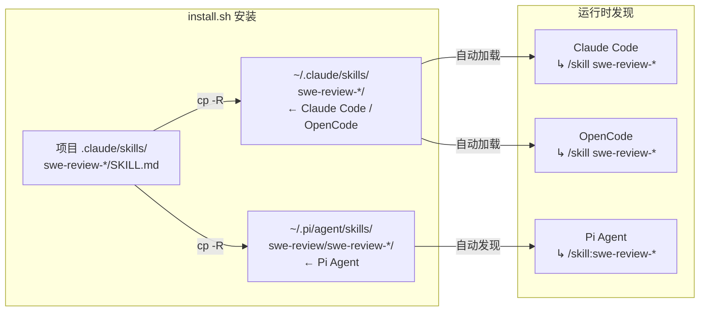

---

## 8. 评测指标

| Metric | 定义 | 本插件在哪收集 |
|--------|------|---------------|
| **CR (Completion Rate)** | reviewer 输出可被**干净**解析为 JSON 的比例（容错修复路径以 `parse_error` / `truncated_repair` 标志另行统计） | `ReviewerSubAgent._parse_response` 成功分支 |
| **DA (Decision Accuracy)** | 4 值决策归并为二元后与 ground-truth 一致（approve + approve_with_suggestions → approve；request_changes + block → request_changes） | `VerifierSubAgent` 提供 oracle 对照（**不进** review prompt） |
| **RRR (Resolve Rate after Revision)** | approved 后实际解决率 | `LoopSkill` 的 `resolve_rate`（= verifier 状态 → 1.0 / 0.5 / 0.0） |

### 评测模式的数据隔离

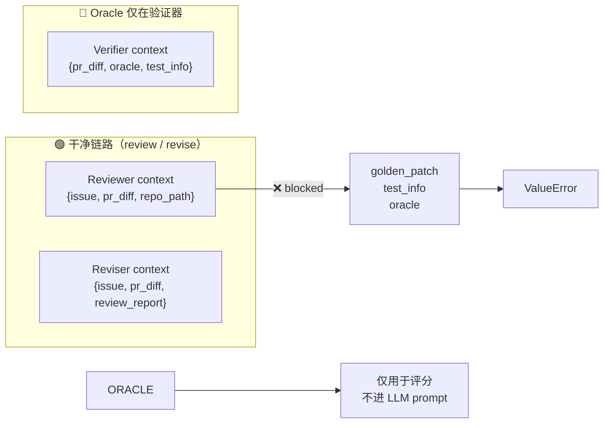

注：本仓库不下载 SWE-bench 数据集；评测脚本请按你本地 SWE-Review-Bench 接入即可。

### 测墙钟/成本时必须先排除缓存

`pi` CLI 会按 prompt 缓存响应。实测**同一条 prompt**：首次 2.86 s，第二次 **0.32 s**
（快 9 倍）。因此：

- 任何复用 prompt 的 A/B 对比都是无效的——**必须在 prompt 里放随机 nonce**；
- 这类污染很容易伪造出「并发没有变慢」的假象（本项目自己就中过一次：一次「分片仅慢
  12%」的结论是缓存命中造成的，真实值是 2× 慢）；
- 报告耗时/成本时请连同 nonce 与 token 计数一起给出，单看秒数不可复现。

同时注意**墙钟由输出生成决定**，不是 prompt 大小：一次调用的耗时 ≈ 输出 token 数 ÷
生成速率，与输入规模关系较弱。所以「把输入切小并并发」不会自动缩短墙钟——除非总输出
也下降。

---

## 9. 安全约束与不变式

### 不变式矩阵

| 不变式 | 执行者 | 违反后果 |
|--------|--------|---------|
| `golden_patch` 不得出现在 review 上下文 | `ReviewerSubAgent.execute()` | `raise ValueError` |
| `oracle` / `test_info` 不得出现在 review 上下文 | `ReviewerSubAgent.execute()` | `raise ValueError` |
| `golden_patch` / `oracle` 不得出现在 revise 上下文 | `ReviserSubAgent.execute()` | `raise ValueError` |
| `golden_patch` / `oracle` 不得出现在 loop 上下文 | `LoopSubAgent.execute()` | `raise ValueError` |
| diff 必须可通过 `git apply` 校验 | `ReviserSubAgent._parse_response()` | `status = "failed"` |
| Verifier 默认使用沙箱 | `VerifierSubAgent.__init__(sandbox=True)` | 污染用户工作区 |
| Reviewer 输出必须是可解析 JSON | `ReviewerSubAgent._parse_response()` | fallback `request_changes` |
| Reviewer 输出内容不得为“空心载荷”（scores 越界/大面积 null、findings 无证据） | `reviewer_agent._parse_engineering_payload()` sanity gate | 视为解析失败，触发 regen/repair 重试 |
| 不可信 review（parse_error / truncated_repair / 空心）不得 approve | `LoopSubAgent` | approve 暂扣，进入 revise/扩张 |
| review_guided 审查通过不能覆盖验证失败（含 hybrid 回退阶段） | `LoopSubAgent._run_review_guided()` | 返回 `success=False`、`final_decision="verification_failed"`，保留候选 diff 与失败详情，不自动修订 |
| best_of_n 的 success 必须 verify 通过 | `LoopSubAgent._run_best_of_n()` evidence-first 裁决 | verify 失败穿透到下一候选 |
| finding location 必须确定性 grounding（可选仓库路径时） | `location_grounding.ground_report_locations()` | 路径不存在→唯一 basename 重定位（记录 `relocated_from`）或标注 `verified=False`；越界行标注 `line_verified=False`；只标注不丢弃，不调用 LLM |
| flat location 字符串会被追加注解后缀（**可观测的 schema 变更**） | `location_grounding._ground_flat()` | `path:line` → `path:line [verified]` / `[unverified]` / `[relocated_from:…;line-verified]`。按裸 `path:line` 解析 `defects[].location` 的下游会看到后缀；需要机器可读定位请用 `--deep`（dict 形态，带 `verified` / `line_verified` / `file_lines` 显式字段）。同一 location 二次 grounding 幂等，不叠加后缀 |
| grounding 不得读取仓库外文件 | `location_grounding._resolve()` containment 检查 | 绝对路径 / `..` 穿越一律不读盘、不泄漏行数，仅可仓库内 basename 重定位 |
| best_of_n wave 内单候选异常不得掀翻整个 wave | `asyncio.gather(return_exceptions=True)` | 失败候选降级为不可信拒绝 |
| 大 diff 必须按文件无损分片（超预算时） | `diff_sharding.plan_shards()` | 一文件的 hunk 不跨片、hunk 不切开、单文件超预算独立成片并标 `oversized`；切分确定性、hunk 与 ± 行守恒；`--no-shard` 可关闭 |
| 分片 findings 的取舍不得交给模型 | `reviewer_agent.merge_findings()` | 并集 + 去重 + 按严重度排序，全部由代码完成；synthesis 调用产出的 findings 被丢弃并由归并结果覆盖；synthesis 不可用 → 退回确定性最坏值聚合（decision 取最严、每维取最低分）；全部片失败 → `request_changes` + `parse_error`，绝不伪造 approve |
| 分片审查必须声明作用域 | `engineering_prompt._shard_scope_section()` | 每片 prompt 注明 `SHARD k/N` 与本片文件清单，并禁止对看不到的文件提「缺失/不一致」——否则必然产出跨文件假阳性 |
| 分片的输出契约必须是 findings-only | `engineering_prompt._shard_task_section()` | 分片只产 `decision`/`findings`/`hard_gate`；评分与 summary 由 synthesis 决定。要求分片产出完整报告会让每片的 completion 接近整轮量级，吃掉并行的全部收益 |
| adapter 不得阻塞事件循环 | 四个 CLI adapter 用 `await asyncio.to_thread(run_subprocess / run_in_pty, …)` | `run_subprocess`/`run_in_pty` 是同步函数；直接调用会让事件循环被阻塞整个子进程生命周期，使项目里**每一处 `asyncio.gather`**（best_of_n 候选波、大 diff 分片、health 探针）表面并发、实际串行。`tests/test_adapters.py::test_cli_adapter_chat_does_not_block_the_event_loop` 强制这一点 |
| 模型产出的 diff 必须过结构校验才准离开 producer | `diff_validation.validate_unified_diff()`，在 `ReviserSubAgent._parse_response` / `GeneratorSubAgent._parse` 中调用 | hunk 算术不对（`@@ -a,b +c,d @@` 与正文行数不符）的 diff，review 会**读文本并批准**它，直到 verify 才以 `corrupt patch` 拒绝——此时已烧掉两轮 review 且没有重试机会。校验器在**产出点**拦下并触发 regen 重试；不通过则交付空 diff，让闭环以诚实的 `revise produced no usable diff` 停止。注意它**必要但不充分**（只查算术，完整可应用性仍需仓库上下文，由验证器裁定） |
| `HostTurnRequired` 绝不被错误隔离吞掉 | `loop_agent._raise_protocol_signals()`，在 `best_of_n` 的 generate/review 两处 `gather(return_exceptions=True)` 之后立即调用 | 它是**控制信号**而非失败：`--tool host` 下表示磁盘上有 prompt 待答。被 `return_exceptions` 转成空候选后，`best_of_n` 会打印 "no candidate approved+verified" 并以退出码 0 收尾，而 rendezvous 目录里留着无人回答的 prompt，调用方永远也学不到下一步该做什么。`review_guided` 一直是对的，只有并发波路径有这个问题 |
| 显式 `initial_pr` 在任何策略下都不得被丢弃 | `_run_review_guided` / `_run_best_of_n` / `_run_hybrid` 三处入口都先判 `initial_pr.get("diff")` | `--initial-pr-diff` 的契约是"审查/修订**这一个**候选"。`best_of_n` 曾经不接受该参数，用户给的 patch 被静默丢弃并改为自行生成；现在跳过生成并记录一条 `generate/skipped` 迭代，使"为什么没有候选被生成"可从 `LoopResult` 直接回答 |
| `--tool` 不得解析到离线占位实现 | `cli._add_tool_arg(default="auto")` → `tools.resolve_adapter_name()`；`AUTO_DETECT_ORDER` 只含四个真实 CLI | 默认值曾是 `shell`：不调用任何 LLM，恒返回固定 `request_changes` 载荷。`review` 不带 `--tool` 会打印一份结构完整、带评分、措辞确信却零分析的报告并以退出码 0 收尾——对"AI 自审 PR"是最危险的失败模式。`auto` 保持"省略该 flag 仍可用"的体验，但只在 `$PATH` 上解析到真实 CLI 时才放行；一个都没装则退出码 2 并列出查找过的二进制名，绝不回落 `shell`。`auto`/`host` 互不越界：`host` 需外部 agent 回答落盘 prompt，也不会被自动选中 |
| 一切调 LLM 的结果都必须显式标注证据降级 | `skill._with_degraded()` / `_degraded_reasons()`，review / revise / generate 共用；输入为 adapter 名 + `exploration_degraded` / `truncated_repair` / `parse_error` | 这些路径都能产出"结构完整但证据为零"的结果。`payload.degraded[]` 让下游（人、CI、上层 agent）不必解析 `summary` 散文即可判断可信度——与 verify 侧 `evidence_level` 同一思路。**三个调模型的 skill 共用同一判定**，否则同一个 `--tool shell` 会在一个命令里被标注、在另一个里装成正常结果：`generate` 尤其需要，因为 `shell` 的固定载荷没有 `diff` 键，解析后得到空 diff——`ok=False` 说明「没产物」，但说不清「为什么没产物」。verify 刻意不标注：它应用补丁并跑命令、不调 LLM，`shell` 对它无影响，标注只会是假阳性；verify 自己的证据契约是 `resolution_status`（弱通过 `patch_applied_only` 由 `LoopResult.verification_status` 透出） |
| `auto` 探测必须与真实执行路径一致 | `tools.detect_adapter()` 只对 adapter **自己解析出的 `cli_path`** 做一次 `shutil.which` | 早先版本用"解析路径 OR 硬编码二进制名"双判据，与 adapter 的真实可执行性存在缝隙：opencode 在有默认安装目录时解析到该目录、否则解析到 `$PATH` 上的名字。接受"任一即可"会选出一次运行时才报错的后端——一个探测结果，一个可执行性问题，不能有两个答案 |
| `auto` 失败必须按**类型**而非消息文本分流 | `tools.ToolNotFound(LookupError)`；`cli.main` 用 `except ToolNotFound` 返回退出码 2 | 早先写法是 `except ValueError` + `if "no LLM CLI found" not in str(exc): raise`——把错误文案变成了控制流，消息一改写就退回裸 traceback；同时其它 `ValueError` 被静默重抛，维护时极易踩坑 |
| 探索降级必须可归因 | `ReviewerSubAgent._explore()` 拆分为 `except asyncio.TimeoutError` 与 `except Exception` 两支，分别写入 `explore_timeout` / `explore_error: …`；异常体经 `_safe_exc_summary()` 截断至 200 字符 | 原写法 `except (asyncio.TimeoutError, Exception)` 等价于 `except Exception`（TimeoutError 本就是 Exception 子类），使真实超时和代码 bug 无法区分，两类降级都以同一副"静态 fallback"面貌出现。降级原因会进入 CLI JSON、再被贴进 issue 和 CI 日志，所以异常消息截断而非原样转发——内部消息可能带绝对路径或配置片段，排障真正需要的是异常类型名 |
| best_of_n 的共享探索必须复用而非重跑 | `ReviewSkill.execute(repo_context=…)` → `ReviewerSubAgent` 跳过 `_explore`；`_tag_shared_exploration()` 在传给 reviewer 时标注空证据 | 每个候选面向**同一** repo + 同一 issue，逐候选重跑 explorer 是纯冗余（实测 N=3 → 3 次完整探索）。探索结果只读、不含候选特定证据，可安全复用。**但复用会绕过逐候选的降级标注**：共享探索返回 `{}`/`None` 时，每个候选都拿到裸空 dict，报告看起来有仓库依据实则零证据——所以标注发生在交给 reviewer 的那一步（generator 仍收到原始 payload，见 `test_best_of_n_wave1_parallel_perspectives_and_shared_exploration`） |
| `token_usage_total` 必须覆盖 generate 与 revise | `GeneratedPR.token_usage` / `RevisedPR.token_usage` + `_accum_tokens` | 此前只累加 review 用量，而这两类恰是输出 token 最多的调用（N 个候选生成 + 每轮修订），成本报告结构性漏掉大头 |
| `install-skills` 不得静默安装 0 个 | `cli._cmd_install_skills()` 在 `installed` 为空时退出码 1 | 默认 `--source` 曾是不存在的 `skills_md/`，命令输出 `{"installed": {}}` 却返回 0 |
| `install-skills` 的源必须与 CWD 无关 | `--source` 默认 `None`，由 `PiAdapter` 解析（包内 `.claude_skills/` 优先，再回退仓库 `.claude/skills/`） | 曾经的默认值是**相对路径**，只有在仓库根目录运行才能找到源；从任何其它目录调用都会失败。现在解析结果恒为绝对路径，`test_install_skills_default_source_resolves_from_the_package` 通过 `chdir("/")` 复跑同一断言来锁定 |
| skill 源必须随包分发 | `scripts/sync_skill_sources.py` 把 `.claude/skills/*/SKILL.md` 镜像到 `swe_review/.claude_skills/`；`pyproject.toml` 的 `package-data` 声明 `.claude_skills/*/SKILL.md` | wheel 只带声明的 package data，而 `.claude/skills/` 在包**外**。此前 `pip install` 后包内一个 skill 源都没有，回退路径指向 `<site-packages>/.claude/skills`（setuptools 从不创建）。已在干净 venv 里用真实 wheel 验证：安装后 `install-skills` 装出 7 个。**不用 `data-files`**——实测它把文件放进 `<name>.data/data/`，安装后落在 `sys.prefix` 而非可导入的包内 |
| `py.typed` 声明与文件必须同时存在 | `swe_review/py.typed`（空 marker，PEP 561）+ `package-data` 声明 | `pyproject.toml` 一直声明 `py.typed` 但文件不存在；已构建 wheel 验证它现在确实被打包。挂在没有类型检查的包上的 marker 会误导下游 |
| adapter 的 CLI 发现不得有永不求值的回退分支 | `opencode_adapter._find_cli()` 先判 `Path(...).is_file()` 再回退 `shutil.which()` | 原写法把 `os.path.expanduser("~/.opencode/bin/opencode")` 直接放在 `or` 链里：`expanduser()` **永远**返回非空字符串，于是它是无条件真值，`shutil.which("opencode")` 成为死代码。结果是用 Homebrew / `npm -g` 装在 `$PATH` 上的 opencode 永远发现不了，adapter 自我报告为未配置——而这会让 `--tool auto` 跳过一台本来可用的后端 |
| 请求策略与实际执行策略必须分开记录 | `LoopResult.strategy`（用户请求）vs `LoopResult.executed_strategy`（真实运行路径） | `best_of_n`/`hybrid` 在显式 `initial_pr` 下会合法地委托给 `review_guided`（没有候选可生成）。此前代码直接覆写 `rg.strategy`，导致 `strategy` 字段不再等于真实编排路径——一个从未生成过候选的运行会自称 "best_of_n"，调试时误导。**归属单一**：`strategy` 只由 `execute()` 写，`executed_strategy` 只由各 `_run_*` 编排器写（只有它们知道发生了委托），`execute()` 仅在字段为空时兜底，绝不猜 |
| token 累计只有一份实现，且契约有测试锁定 | `tools.base.accum_usage()`，由 reviewer / reviser / loop 三处复用；`tests/test_tools_base.py` | 此前有三份近乎重复的累计逻辑（`loop._accum_tokens`、`reviser._accum_usage`、`reviewer._merge_token_usage`），对非数值的处理已经漂移：一份会抛 `TypeError`，另两份会静默存入非法值。CLI 返回的 usage 是不可信 JSON，必须统一忽略非数值。契约的三条（拒 bool、忽略非数值、浮点四舍五入而非截断）各有用例——`bool` 是 `int` 子类，漏掉守卫会让 `{"cached": true}` 给 token 总数 +1 |
| 探测结果在进程内记忆化 | `tools._resolved_cli_paths()` 缓存于 `_CLI_PATHS_CACHE`；`_reset_detection_cache()` 可清除 | adapter 解析路径时会读文件系统（`ClaudeCodeAdapter` 读 `~/.claude/settings.json`），而 `resolve_adapter_name` 一次调用曾构造全部 adapter 两遍（`detect_adapter` 一次、拼错误提示一次）。副作用不该为一个问题跑两次。测试用 autouse fixture 清缓存，否则 monkeypatch 会污染后续用例 |

### Verifier 沙箱流程

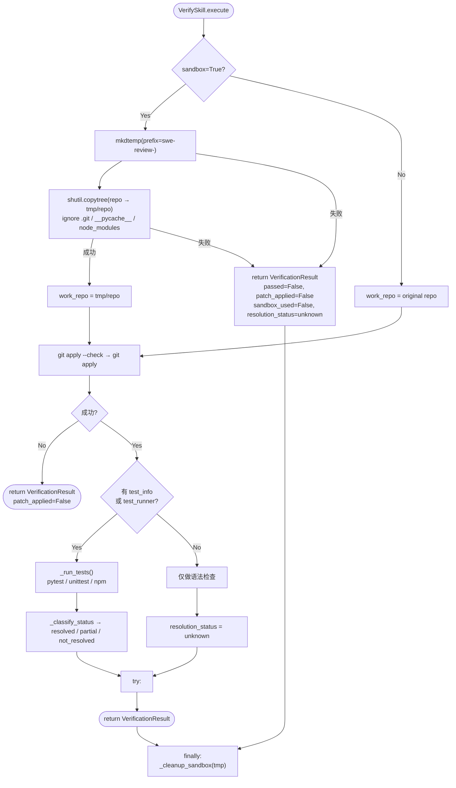

---

## 10. 参考与许可

- 论文：*SWE-Review: Closing the Loop on Issue Resolution with Agentic Code Review*（项目内 `SWE-Review-2607.06065.pdf`）
- 论文：*SWE-Gate: Passing Functional Tests Is Not Enough for Software Engineering Agents*（arXiv:2609.04167；Review-Constraint Deep Check 与 evidence-first 裁决的设计依据）
- Claude Code：`https://code.claude.com`
- Cursor：`https://cursor.com`
- OpenCode：`https://opencode.ai`
- Pi：`https://github.com/badlogic/pi-mono`
- License: MIT
